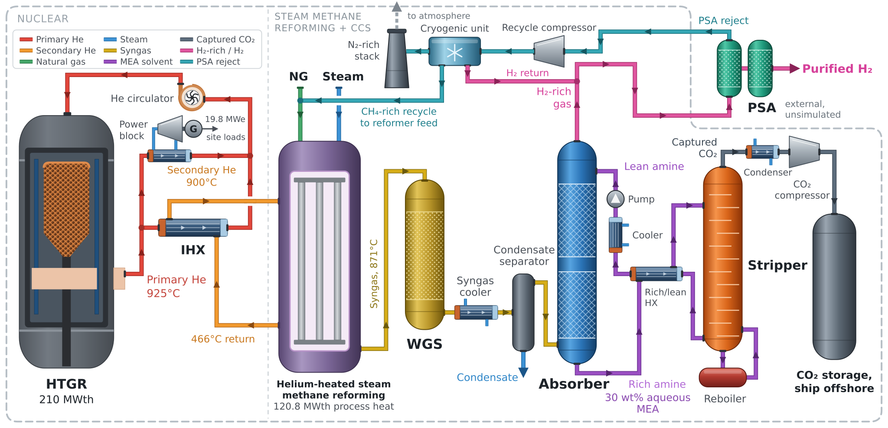

# NUS-H2: Nuclear-upgraded steam methane reforming with carbon capture for low-carbon hydrogen in Singapore

NUS-H2 is a process and techno-economic study of a low-carbon hydrogen plant for Singapore. Steam methane reforming emits the carbon of its feed and its fuel, and the study asks what it costs to abate most of that carbon by moving the reformer heat to a nuclear reactor and capturing the CO2. A high-temperature gas-cooled reactor (HTGR) supplies the process heat for steam methane reforming (SMR), and a monoethanolamine (MEA) unit captures the CO2 for offshore storage. A layered Rust engine computes the mass, energy and carbon balances and two independent cost methods, and the same engine runs in the browser simulator at https://weewzr.github.io/NUSH2/. The final report, presentation and derivations are in the repository. The headline plant meets its abatement target and misses the S$100/t cost target in every central case.

Author: Wee Zhern Ray. MIT licence for the project's own work; third-party material keeps its owners' terms (see [Licence and credit](#licence-and-credit)).

- Simulator: https://weewzr.github.io/NUSH2/
- Final report: [PDF](report/NUSH2_Final_Report.pdf), [DOCX](report/NUSH2_Final_Report.docx)
- Presentation: [PPTX](presentation/NUSH2_Final_Presentation.pptx), [PDF](presentation/NUSH2_Final_Presentation.pdf)
- First-principles derivations: [PDF](math/NUSH2_First_Principles_Derivations.pdf)
- Design record: [docs/FINAL_DESIGN_DECISIONS.md](docs/FINAL_DESIGN_DECISIONS.md); validation record: [docs/VALIDATION_MATRIX.md](docs/VALIDATION_MATRIX.md)

## Process flow



Primary helium from the HTGR passes its heat to a secondary helium loop through the intermediate heat exchanger (IHX), and the secondary helium heats the reformer tubes. The syngas passes the water-gas shift (WGS), is cooled, loses its condensate and enters the MEA absorber. The stripper releases the captured CO2, which is compressed and leaves for offshore storage by ship. The H2-rich gas crosses the boundary to pressure swing adsorption (PSA), an external block that the engine does not simulate. The PSA reject returns across the boundary to a cryogenic unit, which returns hydrogen ahead of the PSA, sends a CH4-rich recycle to the reformer feed and passes an N2-rich cut to a burner and stack. A small power block on reactor heat generates 19.8 MWe for the site loads. The dashed line in the figure is the boundary used for the carbon accounting.

## Scope and design basis

In this repository SMR always means steam methane reforming, and a small modular reactor is always written in full.

The headline plant is Case B: 100,000 Nm3/h of purified hydrogen, or 66,925 t/y at 85% availability. It is sized to the SOXAL hydrogen plant on Jurong Island and sited on the proposed Western Island reclamation, which is the author's proposal with no official approval. A 210 MWth HTGR heats the reformer with 120.8 MWth of process heat from 900 C secondary helium. The plant needs 178.5 MWth in all, so 31.5 MWth is held as margin with no revenue. Fresh natural gas is 23.2 MMSCFD, 12.6 MMSCFD below an unabated SMR of the same output.

The MEA unit captures 90% of the CO2 at the absorber in each pass and 90.4% of the plant carbon. Net abatement is 0.578 Mt/y of direct emissions to atmosphere, counted against INL's unabated baseline of 9.21 kg CO2 per kg H2. That meets the abatement target of 250,000 t/y.

Case A, INL's 130 MMSCFD plant of TEV-961, is kept as the reference case and is never presented as a 210 MWth plant.

## Model and method

### Balances

The engine is a steady-state model of the plant inside the dashed boundary. It writes three balances to `results/`:

- The mass balance, `results/Integrated_Mass_Balance.csv`, holds each flowsheet stream with its total and carbon flows in kmol/h and its temperature.
- The energy balance, `results/Integrated_Energy_Balance.csv`, holds the heat and power rows in MW by closure group. In the `reactor`, `reboiler`, `electricity` and `envelope` groups the sources equal the sinks.
- The emissions ledger, `results/Emissions_Ledger.csv`, holds the carbon captured, the direct emissions to atmosphere and the abatement against each baseline, per run.

Each term of the plant model has an anchored value taken from INL and, where one exists, a modelled value from the engine's unit operations. Three presets combine them. Anchored uses the anchored values. Headline and Modelled move a term to its model only where the gate row of that term passes in `results/Validation_Results.csv`: at this revision Headline moves the syngas heat above 130 C (term T05), and Modelled moves T05 and the carbon split after shift (T01). `nush2 drift` prints the three presets side by side, and section "Drift between headline and modelled terms" of the [design record](docs/FINAL_DESIGN_DECISIONS.md#drift-between-headline-and-modelled-terms) lists every term and its gate.

### Cost method

Costs are levelised abatement costs in S$ per tonne of CO2 abated, against an unabated SMR of equal hydrogen output. Two independent methods run on one cost set.

The annual incremental ledger sums the annual cost differences $\Delta C_k$ (S$/y) of each line $k$ against the unabated SMR and divides by the net abatement $A$ (t/y):

$$\mathrm{AC}_{L} = \frac{\sum_{k \in L} \Delta C_k}{A}$$

The lines are added in levels L0 to L5. L0 holds the gas saved, the reactor and capture capital, capture fixed O&M and CO2 transport and storage; L1 adds reactor O&M and fuel; L2 the IHX and secondary loop; L3 extra licensing and decommissioning; L4 the interest during construction, the power island and the recycle train; L5 the lost steam export and the avoided grid power. L5 is the full cost. The full ladder is in [section 6 of the design record](docs/FINAL_DESIGN_DECISIONS.md#6-ledger).

The discounted cash flow (DCF) runs year-by-year real cash flows at a discount rate $r$ of 8% for the two plants on a common horizon and discounts the tonnes abated at the same rate:

$$\mathrm{LAC}_{\mathrm{DCF}} = \frac{\sum_t \left(C^{\mathrm{NUS}}_t - C^{\mathrm{SMR}}_t\right)(1+r)^{-t}}{\sum_t A_t (1+r)^{-t}}$$

The levelised cost of hydrogen (LCOH) of each plant is the present value of its costs over the present value of its hydrogen, in S$/kg.

### Main assumptions

| Quantity | Central value | Range or alternative |
|---|---|---|
| Availability | 85% | 65% to 90% tested |
| Discount rate, real | 8% | |
| Plant life | 25 y | 40 y and 60 y |
| Reactor size exponent | n = 1.0 | |
| Reactor charge | 210 MWth rating | 178.5 MWth need |
| Cost basis | BOAK (INL/RPT-23-72972 Table 1) | FOAK; tenth of a kind on the BOAK learning route |
| Natural gas price | S$15/GJ | S$10 to S$20/GJ |
| Specific reboiler duty | 3.8 GJ/t CO2 | 3.4 to 4.2 GJ/t CO2 |
| CO2 transport and storage tariff | S$60/t | S$23.2 to S$112/t |
| Per-pass capture at the absorber | 90% | 80%, 85% and 95% tested |
| Reformer exit temperature | 871 C (INL equilibrium assumption) | 825 C and 800 C |
| Unabated baseline | 9.21 kg CO2 per kg H2 (INL) | |

The values are held in `results/`, and the source of each input is in `engine/data/parameters.toml`.

### First-principles derivations

`math/NUSH2_First_Principles_Derivations.pdf` derives each equation the engine uses. It opens with a Reference Frame of the variables, equations and assumptions, and every card links to its engine item and test through `math/eq_register.csv`. Worked numbers enter it only through `scripts/derivations_tools.py values`, which reads the results files and `build/numbers_tokens.csv`. The build order is in the docstring of `scripts/derivations_tools.py`; the Tectonic step runs in `math/`:

```sh
cd math && tectonic NUSH2_First_Principles_Derivations.tex
```

### Provenance

- `engine/data/parameters.toml` is the only file that holds a project input. Each entry states its class (published, assumed, calculated or author decision), its rigour, its source with a table or page locator, and whether that source was read at first hand.
- The exporter is the only writer of `results/`. Documents take their numbers from `results/` through `build/numbers.json`, and this README is filled the same way.
- The design record labels each value as published, assumed, calculated or an author decision, and cites the source page.
- `references/README.md` lists every cited work. Papers are cited and are not redistributed.

## Install

- Rust through rustup. `rust-toolchain.toml` pins Rust 1.96.0 with rustfmt, clippy and the `wasm32-unknown-unknown` target; `rustup toolchain install` in the repository root installs all of them.
- Python 3.10 or later for `scripts/`. The scripts use the standard library only.
- Chrome or Edge for the browser self test, `scripts/selftest.py`.
- Tectonic for the derivations PDF.

## Run

```sh
cargo test --workspace
cargo run --release -p nush2_cli -- export --out target/results
python scripts/compare_results.py results target/results
cargo run --release -p nush2_cli -- drift
python scripts/build_numbers.py
```

The first command runs the code tests in the dev profile. The export writes the seven results files to `target/results`, and `compare_results.py` checks them against the committed `results/`. `drift` prints the Anchored, Headline and Modelled presets side by side. `build_numbers.py` builds `build/numbers.json` from `results/`.

`nush2 export --out results` rewrites the committed results. The release profile uses fat link-time optimisation, so release builds are slow.

The simulator site:

```sh
python scripts/build_wasm.py --out target/site-wasm/nush2.wasm
python scripts/check_wasm.py target/site-wasm/nush2.wasm
python scripts/build_site.py --wasm target/site-wasm/nush2.wasm --results results --out _site
python scripts/check_site.py --site _site --repo .
python scripts/selftest.py --site _site
python -m http.server --directory _site 8000
```

The last command serves the site at http://localhost:8000/.

The browser self test also checks that every unit on the process flow diagram has an accessible name containing its printed label, that scrolling tables and equations take keyboard focus, and that the equipment and stream list selects the same item as the drawing. The interface review, including the evaluation of the Astryx component library (no component adopted) and its measurements, is in section 8 of [docs/UI_UX_ASSESSMENT.md](docs/UI_UX_ASSESSMENT.md).

## Results

Every plant and cost value in this README comes from the engine's exported `results/` through `build/numbers.json`. To reproduce them, run the export and the comparison in [Run](#run); `python scripts/build_numbers.py --verify` then confirms that `build/numbers.json` still matches `results/`.

### Case B plant

| Quantity | Value | Unit | Row of `results/Final_Design_Basis.csv` |
|---|---|---|---|
| Purified hydrogen | 100,000 | Nm3/h | `H2_B` |
| Hydrogen at 85% availability | 66,925 | t/y | `RES_H2_T_Y` |
| Process heat to the reformer | 120.8 | MWth | `RES_PROCESS_HEAT_MW` |
| Reactor heat needed | 178.5 | MWth | `RES_REACTOR_NEEDED_MWTH` |
| Margin against the 210 MWth rating | 31.5 | MWth | `DRIFT_HEADLINE_SPARE_MWTH` |
| Fresh natural gas | 23.2 | MMSCFD | `RES_NG_MMSCFD` |
| Natural gas, unabated SMR of equal output | 35.9 | MMSCFD | `RES_NG_UNABATED_MMSCFD` |
| Plant carbon captured | 90.4 | % | `RES_PLANT_CAPTURE` |
| Net abatement, direct emissions to atmosphere | 0.578 | Mt/y | `RES_ABATEMENT_T_Y` |
| Site electricity from the power block | 19.8 | MWe | `RES_E_TOTAL_MWE` |

### Abatement cost, central cases

Costs below have the reactor charged at its 210 MWth rating and a size exponent n = 1.0. The ledger's level L5 is the full cost.

| Base full cost | L5 (S$/t) | DCF (S$/t) | Named step L3 (S$/t) |
|---|---|---|---|
| BOAK, 25 y | 189.7 | 190.1 | 137.7 |
| BOAK, 60 y | 165.6 | 166.0 | 117.2 |
| FOAK, 25 y | 277.9 | 278.4 | 209.9 |
| FOAK, 60 y | 241.7 | 242.2 | 179.5 |

These are the rows `AC_L5_*`, `LAC_DCF_*` and `AC_L3_*` with suffix `_N1P00` of `results/Final_Design_Basis.csv`. FOAK is the first of a kind. BOAK is INL's cost basis between the first and the nth of a kind (INL/RPT-23-72972 Table 1). L3 is a named step of the ledger: it stops before the interest during construction, the power island, the recycle train, the lost steam export and the avoided grid power, which L4 and L5 add. The levelised cost of hydrogen is S$3.62/kg for the unabated SMR and S$5.26/kg for NUS-H2 at BOAK over 25 y (S$5.05/kg over 60 y).

**The S$100/t target is missed in every central case.** 0 of the 8 central cases (L5 and DCF, BOAK and FOAK, 25 y and 60 y) reach it. The lowest L5 in the n = 1.0 family is the tenth of a kind over 60 y with the reactor charged at its 178.5 MWth need, S$108.5/t.

### Named scenario MATURE_60Y

Its conditions are stated together: the tenth of a kind on INL's BOAK learning route (stage 10OAK_P46, INL/RPT-23-72972 PDF p46), a 60 y life, n = 1.0, the reactor charged at 210 MWth, and natural gas at S$20.7/GJ against the central S$15/GJ. Under those conditions the full cost is S$95.6/t on L5 and S$95.9/t on the DCF, below the S$100/t target. The gas price is the engine's solve for the author's mature-scenario target of S$96/t (S$20.63/GJ on L5 and S$20.68/GJ on the DCF), rounded up to 0.1. Dearer gas lowers the abatement cost because NUS-H2 burns less gas than the unabated plant it is compared with. S$20.7/GJ lies outside the gas ranges the engine holds: above the S$10 to S$20/GJ sensitivity range (rows `GAS_LOW` and `GAS_HIGH` of `results/Final_Design_Basis.csv`) and above the S$10 to S$20/GJ evidence range of the central price (the low and high of row `GAS_CENTRAL`), so the scenario rests on a gas price beyond the evidence in the engine inputs. At S$20/GJ, the top of the tested range, it gives S$99.6/t on L5 and S$99.9/t on the DCF. The base full cost above stays the reference result.

| Step-down to MATURE_60Y | L5 (S$/t) | DCF (S$/t) |
|---|---|---|
| 1. Base: BOAK, 25 y, gas at S$15/GJ | 189.7 | 190.1 |
| 2. Tenth of a kind (10OAK_P46), 25 y | 146.3 | 146.6 |
| 3. Tenth of a kind, 60 y | 128.2 | 128.5 |
| 4. Tenth of a kind, 60 y, gas at S$20.7/GJ | 95.6 | 95.9 |

Each step changes one condition of the step above it (rows `STEPDOWN_` of `results/Sensitivity_Results.csv`).

## Verification and validation

`cargo test` checks code correctness and is kept apart from the literature benchmarks. CI (`.github/workflows/ci.yml`) runs a text guard (`scripts/check_clean.py`), `cargo fmt --check`, `cargo clippy` with warnings as errors and `cargo test --workspace`. The site workflow also regenerates the results and compares them with the committed ones before it builds and self-tests the site.

As exported with this revision, `results/Validation_Results.csv` holds 650 rows: 325 pass, 32 fail, 251 are reported with no limit and 42 did not run, each with its reason. Of the passes, 92 use data that played no part in building or tuning the engine term under test, and one of those, TAN-TREND, judges a trend only; the rest are calibration or share a dataset with an engine input, and earn no validation credit. A failed benchmark stays recorded as failed. No constant was tuned and no tolerance was changed to make a row pass.

The failed rows are `DICE-SRD`, `FS_CARBON_VS_ANCHOR_BURNED`, `FS_CARBON_VS_ANCHOR_RECYCLED`, `FS_CARBON_VS_ANCHOR_TAIL_GAS`, `FS_CARBON_VS_ANCHOR_TUBE`, `FS_GATE_M7`, `GATE_T02`, `GATE_T04`, `GATE_T06`, `GATE_T07`, `GATE_T08`, `GATE_T09`, `GATE_T13`, `HA-3`, `JA-A-2-X`, `JA-A-2-X-UNCAL`, `JA-A-3-X`, `JA-A-3-X-UNCAL`, `JA-A-5-X`, `JA-A-5-X-UNCAL`, `KW-SRD`, `MO-K16-TOUT`, `PROPS-SHOMATE-CP`, `SA-1`, `T953-2`, `T961-1-ROT825C`, `T961-5-GHSV-CO`, `T961-5-GHSV-T`, `VER-2-298K-PennyRitter1983`, `VI-3-SS2`, `VI-3-SS3`, `XF-3-III-948K`.

The consequences are carried into the results. The column gate failed, so the specific reboiler duty stays at the assumed 3.8 GJ/t in the Headline preset. The Level 3 carbon gate failed, so the recycle slip heat, CO2 compression and natural gas terms stay on their INL-anchored values. Only the syngas heat above 130 C runs on its model in the Headline preset. No crate carries the author's sign-off yet, and [docs/VALIDATION_MATRIX.md](docs/VALIDATION_MATRIX.md) gives each benchmark's limit, source page and status.

| Crate | Model class |
|---|---|
| `nush2_props` | Empirical helium and syngas transport fits; equilibrium constants and species data from published tables |
| `nush2_mea` | Rigorous: extended UNIQUAC |
| `nush2_units` | Equilibrium reformer and coolers rigorous; reformer tube, low-temperature shift, flash, absorber, stripper, regeneration, IHX and circulators reduced order; high-temperature shift empirical |
| `nush2_plant` | Ledger arithmetic on fixed-assumption inputs; the Level 3 flowsheet assembles the units above; the PSA is an external boundary |

## Limitations

- The specific reboiler duty of 3.8 GJ/t (range 3.4 to 4.2) is an assumption with no measurement on syngas, and the modelled stripper misses the pilot and design benchmarks it is judged on.
- The PSA is an unsimulated external block, and INL does not publish how its purge recovery power row splits between fuel-gas recycle and nitrogen removal.
- The TEV-961 Case 6 stream sheets are not held. Case 5 stands in for the unit tests, so a pass there says nothing direct about Case 6.
- 871 C at the reformer exit is INL's equilibrium assumption. The engine's tube model reaches 782.1 C at 199 tubes, and the 825 C and 800 C cases run as sensitivities.
- The cryogenic unit is INL's fixed-assumption block, drawn for the small CO2 slip of Selexol; with MEA at Case A the absorber slip is about ten times larger. If the recycle does not carry over, abatement falls towards 467,353 t/y and the gas rises towards 30.4 MMSCFD.
- At the high corner of the heat balance the plant needs 214.1 MWth, above the 210 MWth rating. The rated reactor still covers the heat duties there and imports a little electricity.
- Liquefaction for ship transport is not modelled. INL's pipeline compression load stands in for it, and the T&S tariff of S$60/t (S$23.2 to S$112) is assumed.
- Reactor capital comes from INL's literature review of cost estimates, and no vendor quote is held for this plant. The IHX and extra licensing costs are proxies that were not opened at source.
- The 85% availability is assumed; the library holds no measured HTGR availability.
- Western Island reclamation has no date, so the site timeline is illustrative.
- The S$100/t cost target is missed in all 8 central cases. Only the MATURE_60Y scenario reaches it, and that scenario rests on a gas price of S$20.7/GJ, above the range the engine inputs support.

## Repository layout

| Path | Contents |
|---|---|
| `engine/` | Rust workspace of the engine, one crate per layer (table below) |
| `engine/data/parameters.toml` | Every input number, each with its class, rigour, source, locator and decision |
| `results/` | The seven CSV files that `nush2 export` writes: design basis, mass and energy balances, emissions and economic ledgers, sensitivities and validation |
| `frontend/` | The browser simulator: static HTML, CSS and JavaScript around the WebAssembly engine |
| `math/` | First-principles derivations: LaTeX source, equation register and the built PDF |
| `scripts/` | Python build and check scripts, standard library only |
| `docs/` | Design record, validation record, interface review and the process flow figure |
| `references/` | Citation list with DOIs and URLs; no paper is redistributed |
| `report/` | Final report, PDF and DOCX |
| `presentation/` | Final presentation, PPTX and PDF |
| `.github/workflows/` | `ci.yml` (text guard, format, lint, tests) and `site.yml` (tests, results check, site build, browser self test, Pages deploy from `main`) |

| Crate | Role |
|---|---|
| `nush2_numerics` | Shared error type and small numerical helpers |
| `nush2_props` | Ideal-gas thermochemistry, mixtures, reforming equilibrium, IF97 water, helium and syngas transport |
| `nush2_mea` | MEA solvent thermodynamics, extended UNIQUAC after Aronu et al. (2011), and solvent properties |
| `nush2_units` | Unit operations: gas units, reformer tube, absorber, stripper and regeneration train, IHX and helium circulators |
| `nush2_plant` | Plant model: anchored plant, annual ledger, DCF, Level 3 flowsheet, Level 4 heat recovery, term gates and the exporter |
| `nush2_vv` | Benchmark harness that writes `results/Validation_Results.csv` |
| `nush2_cli` | The `nush2` command line, the only crate that touches the disk |
| `nush2_wasm` | Browser build of the engine, a plain cdylib that imports nothing; see [engine/wasm/README.md](engine/wasm/README.md) |

## Licence and credit

MIT licence, see [LICENSE](LICENSE). Copyright (c) 2026 Wee Zhern Ray. Third-party images and Rust crates are outside that licence; see the notice below and [THIRD_PARTY_NOTICES.md](THIRD_PARTY_NOTICES.md) beside `LICENSE` in the repository root.

**Third-party content.** Figures and photographs in the report and the presentation that are credited to other sources, and any other third-party image in them, belong to their owners. They are not covered by the MIT licence, and this repository grants no right to reuse them. Each one is listed by slide or figure, with what it shows and its source as printed, in [THIRD_PARTY_NOTICES.md](THIRD_PARTY_NOTICES.md#third-party-images-in-the-report-and-the-presentation). The Rust crates compiled into the engine and its WebAssembly module keep their own licences, listed with their full texts in [THIRD_PARTY_NOTICES.md](THIRD_PARTY_NOTICES.md).

OUTRAM PARK (github.com/theodoreOnzGit/outram-park-backend) was consulted as a reference; no OUTRAM PARK code is included and no endorsement is implied. The concepts drawn from it, each checked by this repository's own tests, are listed at the end of [docs/FINAL_DESIGN_DECISIONS.md](docs/FINAL_DESIGN_DECISIONS.md#concepts-drawn-from-outram-park).
